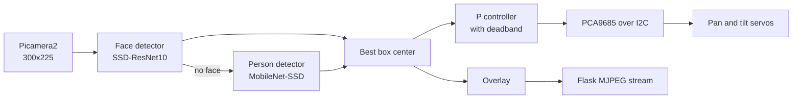

# Auto-Turret

My snacks kept disappearing... so I built an autonomous turret to protect them. It spots a person and follows them around the room, running fully on a Raspberry Pi 5 with no GPU.

https://github.com/user-attachments/assets/3721efa2-5bd6-4499-8468-93d212292350

## The problem

Following a person with a camera sounds simple, but on a Pi it's a budget problem. Face detectors lose the target as soon as someone turns around or walks away, body detectors are too coarse to aim with up close, and running both on every frame on a CPU is too slow to drive servos smoothly.

## What I built

A single Python process that reads the camera, detects, steers two servos and streams an annotated video feed to any browser on the network.

- Face first, body as fallback, so the rig keeps following when the face is lost
- 15 to 20 fps on a Pi 5 (4 GB) CPU at 300x225
- A scan pattern that sweeps the room when the target has been gone for 2 seconds
- Live MJPEG stream on port 5000 and a small JSON status endpoint
- Hardware cost under 100 USD

This public version has no firing, relay or trigger logic. It's a tracker for camera, laser pointer and human-robot interaction demos.

## Architecture



Everything lives in `src/auto-turret-tracker.py`. The control loop runs inside the frame generator of the video stream, so one loop iteration is one camera frame, one detection, one servo update and one JPEG.

| Part | Choice |
|---|---|
| Compute | Raspberry Pi 5, 4 GB |
| Camera | Raspberry Pi Camera via Picamera2 |
| Servo driver | PCA9685, 16 channel PWM, 50 Hz |
| Servos | 2x MG90S on channels 0 (pan) and 1 (tilt) |
| Vision | OpenCV DNN, Caffe models in `models/` |
| Web | Flask |

## Design decisions

- Two detectors in a cascade. The face model runs on every frame. The person model runs only when there is no recent face, so the common case costs one forward pass.
- Low resolution on purpose. 300x225 matches the 300x300 network input, and it's what gets the loop to 15 to 20 fps on the CPU.
- Proportional control with a deadband. The pixel error from frame center is multiplied by a gain of 0.05 and ignored inside 8 px. The deadband keeps cheap MG90S servos from hunting around the center, and there is no integral or derivative term to tune.
- Hold before scanning. After losing the target the rig waits 2 seconds where it is, then sweeps pan end to end while tilt follows a sine wave, which covers the room without a second motion planner.
- Angles are clamped to the mechanical limits of the rig (pan 20 to 160, tilt 50 to 130) before every write, so a bad detection can't drive a servo into its end stop.
- MJPEG over Flask instead of WebRTC. Any phone or laptop can open it with no client code, and the latency is fine on a home network.

## Setup

On the Pi, install the camera and OpenCV bindings from apt and make the venv see them. Picamera2 does not install cleanly from pip alone.

```bash
sudo apt install -y python3-picamera2 python3-opencv
```

```bash
git clone https://github.com/elie-hallermeier/Auto-Turret.git
```

```bash
cd Auto-Turret && python3 -m venv --system-site-packages venv && venv/bin/pip install -r requirements.txt
```

Enable I2C in `sudo raspi-config` (Interface Options).

Wiring:

- PCA9685 SDA and SCL to the Pi's SDA and SCL, VCC to 3.3V
- PCA9685 V+ to a separate 5V servo supply, with ground shared with the Pi
- Pan servo on channel 0, tilt servo on channel 1

The four model files are already in `models/` and are loaded from there.

## Run

```bash
venv/bin/python src/auto-turret-tracker.py
```

The servos center, then the stream is at `http://<pi-ip>:5000/`. Status as JSON is at `/api/status`.

Tuning lives in the config block at the top of the script: servo limits, gains, deadband, scan range, detector thresholds. If tilt moves the wrong way, flip `TILT_DIR`.

## Next

- Swap the Caffe models for YuNet to get more frames per second
- Move the config block to a file
- A WebSocket API for remote control

## License

MIT, see [LICENSE](LICENSE).
